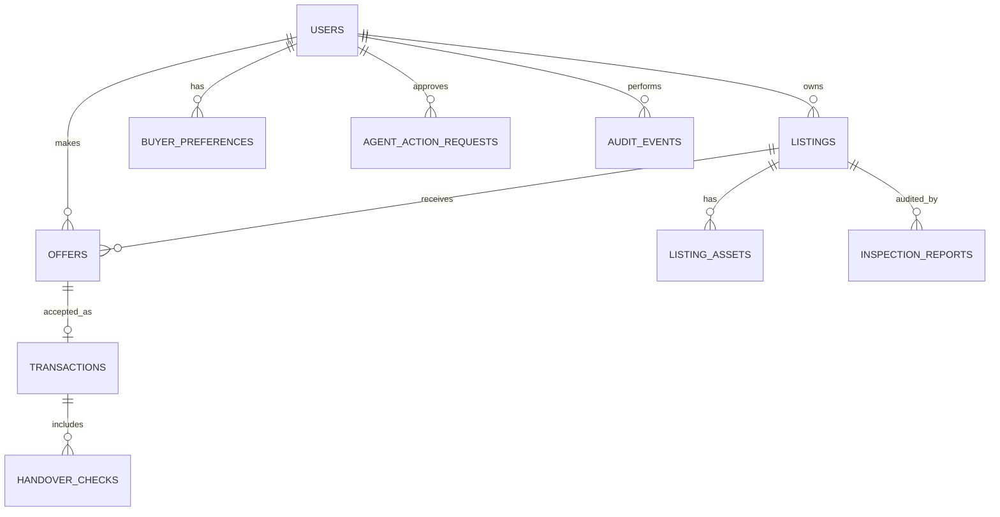
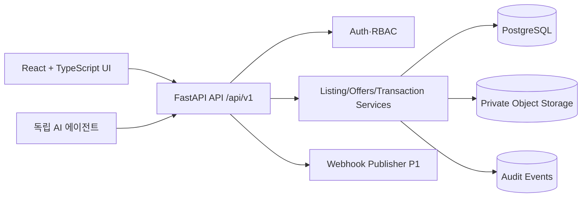

# 초소형 디지털 프로젝트·온라인 사업 거래 플랫폼 — 전체 기획·설계·개발 명세서

**문서:** MARKET-PRD/SRS v1.0 · **작성:** 2026-11-12 · **상태:** 설계 기준선(구현 전)  
**대상:** 대한민국 개인 개발자·1인 창업자 · **공식 서비스명 미정** (`micro-asset-market`은 내부 코드명)  
**연동:** 독립 Streamlit AI 에이전트 (`01`), 공통 API (`03`), 스키마 (`04`), 수용테스트 (`05`)

> **비용 최우선 규칙:** Replit Agent 자동 개발·수정·배포 호출을 절대 사용하지 않는다. 모든 코드는 ChatGPT에서 직접 제작하고, 파일/ZIP으로 사용자에게 건네 Replit에 **수동 업로드/실행**한다. 예상치 못한 Max Mode 과금 피해 재발 방지. 이 명세서를 기반으로 AI 빌더나 Replit Agent를 시작하지 않는다.

## 0. 제품의 한 문장 정의

**완성·미완성·실패·운영 중인 초소형 디지털 프로젝트를 판매자가 안전하게 재유통하고, 구매자는 실제 인수해 활용할 수 있는지 확인하면서 거래하는 한국형 디지털 자산 마켓플레이스.** 장기적으로 별도의 AI 에이전트가 분석·추천·협상·인계 검증을 수행한다.

`거래되는 것`은 물리적 물건이 아니라 소스코드·실행 프로그램·서비스 구성·디자인·콘텐츠·운영 노하우 등의 명확하게 특정된 디지털 자산/사용권/운영권이다. **서로 다른 법적 권리를 동일한 '사업 매매'로 포장하지 않는다.**

### 0.1 프로젝트 원칙

1. 가격 중심대: KRW **50,000 ~ 1,000,000** (기능상 상한 제한 없음). 저가 매물 수수료 구조는 별도 설계.
2. 성공한 수익형 프로젝트뿐 아니라 개발 중단·실패·미출시 프로젝트를 적극 수용. 단, 무단 복제·권리 불명/양도 불가 자산은 공개·거래 제한.
3. 구매자가 *실제로 얻는 자산/권한/기능*과 *받지 못하는 항목*을 명확히 표시.
4. 첫 단계에 실제 결제·에스크로·계약 확정·AI 동적 코드 실행 **미포함**. 실제 서비스 출시 준비는 별도 P2.
5. 에이전트가 플랫폼 공개 API와 위임 권한을 통해 거래를 지원할 수 있게 **API-first** 구현.
6. 상업적 증거, 인증, 성공/매출 수치를 위조하지 않는다. DEMO 매물은 DEMO로 명시.
7. React + TypeScript 프런트 / Python FastAPI 백엔드 / PostgreSQL / 사설 객체 저장소 권장. Replit 종속을 최소화.

## 1. 사용자 문제·경쟁 대안·차별화 가설

### 1.1 공급자 문제

- 수익화 실패·사업 포기로 프로젝트가 방치됨. 소액 자산을 정리하고 이전하는 비용이 판매 대금보다 클 수 있음.
- 구매자가 검증할 수 있도록 실행환경·라이선스·소스·외부 의존성을 정리하기 어려움.
- 판매 후 지원 범위와 권리 이전 내용을 명확히 하지 않으면 분쟁·추가 무상 노동이 발생.

### 1.2 구매자 문제

- 작은 앱·코드라도 직접 개발에 비해 시간을 절약할 수 있지만 실행 여부, 품질, 향후 운영 비용 불명.
- 개발 경험이 없는 구매자는 타인의 소스코드가 자신의 환경에서 운영 가능한지 판단 어려움.
- 소스 자산의 진짜 권리자, 오픈소스/유료 에셋 라이선스, 계정 이전 가능성 구분 어려움.

### 1.3 경쟁 서비스 대비 가설

기존 사이트·앱·사업 매매 플랫폼과 경쟁할 때, 단순히 '더 싼 매물'이나 'AI 추천'만으로는 우위가 부족하다. 다음 조합을 집중 검증한다.

- **초소형·무매출/실패 프로젝트 친화적 등록**: 재판매 가능한 자산을 쪼개어 매물화.
- **검증 중심 상품 상세**: 실행·권리·의존성·유지비·인계 범위와 각각의 확인 상태를 구조화.
- **인계 가능 조건 협상**: 가격과 복구 작업, 지원 기간, 테스트 완료 조건을 하나의 제안에 명시.
- **독립 AI 에이전트 연동**: 프로젝트 소스 분석 → 보완/재판매 준비 → 추천 → 협상 초안 → 인계 체크. 다만 실제 우위는 파일럿에서 검증해야 함.

이 차별화는 시장의 공백이 **증명됐다는 의미가 아니라** 실험할 제품 가설이다.

## 2. 제품·사업 범위

### 2.1 판매 대상 분류

| 카테고리 | 예시 | 특이 검증 포인트 |
|---|---|---|
| `web_app` | 소규모 웹앱·대시보드 | 서버·DB·도메인·시크릿 이전 |
| `saas` | 구독형 SaaS MVP | 구독·개인정보·결제 공급자 양도 여부 |
| `desktop_tool` | Python/JS 유틸리티 | 실행환경·OS·라이선스 |
| `ai_agent` | 업무 자동화 에이전트 | 모델 API·비용·프롬프트·툴 권한 |
| `mobile_app` | 앱 프로토타입 | 스토어 등록·계정 이전 절차 |
| `game` | 작은 웹게임/게임 소스 | 아트·음원·엔진 에셋 권리 |
| `module` | 컴포넌트·API·디자인 모듈 | 독점 판매 가능성·의존성 |
| `content_asset` | 사이트 콘텐츠·템플릿 | 저작물 권리·재판매 허락 |
| `revenue_site` | 운영 중인 수익형 사이트 | 매출 증빙, 트래픽, 고객 계약 |

매출 없는 자산도 허용. 위 범주는 사용자가 보고 비교할 수 있게 하는 비즈니스 카테고리이며 법적 권리 양도 가능성을 의미하지 않는다.

### 2.2 별도 표시할 프로젝트 라이프사이클

- `UNLAUNCHED` 미출시, `IN_DEVELOPMENT` 개발중/미완성, `DISCONTINUED` 운영 중단, `FAILED_COMMERCIALIZATION` 사업화 실패, `OPERATING_NO_REVENUE` 운영중·무매출, `OPERATING_REVENUE` 수익 발생, `ASSET_ONLY` 코드/부품 자산만.
- '실패' 자체는 판매가 불가능하다는 의미가 아니며, 수익 여부와 기술 완성도는 독립 필드.
- `revenue_claim`/`profit_claim`은 검증 전에는 **판매자 주장**으로 표시. 증빙이 없으면 null/미확인.

### 2.3 거래 권리 유형

- `FULL_IP_ASSIGNMENT`: 권리 범위가 적힌 저작재산권 양도 예정.
- `EXCLUSIVE_LICENSE`: 독점 사용허락. 양도와 다르므로 라벨 명시.
- `NON_EXCLUSIVE_LICENSE`: 비독점 사용권, 다중 판매 가능.
- `ASSET_TRANSFER_ONLY`: 특정 파일·디자인·설정 등 자산만 양도 예정.
- `BUSINESS_TRANSFER_REVIEW_REQUIRED`: 영업 전체 양도 구조가 필요한 경우 P2 검토 대상으로 분류.

MVP에서 유형을 선택한다고 계약이 체결되는 것은 아님. 권리자 진술·증빙·별도 계약이 필요.

## 3. 페르소나와 핵심 여정

### 3.1 판매자

- S1 개인 개발자: 30만 원에 완성한 Python 유틸리티 판매. 문서·시연 영상 제공.
- S2 실패 창업자: 무매출 AI 웹앱 판매. API 비용·미완성 기능과 명시된 결함을 공개.
- S3 운영 중인 1인 SaaS: 제한된 범위의 코드 자산 판매 또는 사업 전체 이전 사전 상담.

**여정:** 회원가입 → 신원/연락 확인 → 자산 종류 선택 → 권리/포함·제외 항목 표시 → 필수 기술·상태·가격 입력 → 공개 가능한 썸네일/설명 업로드 → 비공개 소스 저장 → 검토·게시 → 제안 확인 → 역제안 → 승인·인계 준비 → 인계 체크.

### 3.2 구매자

- B1 학습·개조 목적: 5만 원대 작은 코드/앱 찾기.
- B2 사업 시작 목적: 50만 원대 미출시 SaaS를 인수해 리브랜딩.
- B3 개발 대행자: 특정 기능 모듈 재사용, 권리 범위 중요.

**여정:** 검색/탐색 → 예산·카테고리·상태·권리 필터 → 상품 상세의 '검증/미검증/미해결 위험' 확인 → 찜 → 제안/조건 협의 → 상대 수락 → 인계 자료 및 확인 → 완료(실거래는 출시 이후).

### 3.3 관리자

신고·권리 분쟁·상세페이지 허위 표시·불법 자료·악성코드 의심 제출·매물 미검증 표시·DEMO와 LIVE 분리 관리. 임의 가격 조작이나 사용자 대신 거래 합의 금지.

## 4. 페이지 구성과 UI/UX

| 화면 | 필수 UI 및 행동 | 우선순위 |
|---|---|---|
| 홈 | 검색, 카테고리, 신규·합리적 가격 매물, 실패/중단 프로젝트 설명 | P0 |
| 매물 검색 | 키워드, 가격 범위, 상태, 자산 형태, 기술스택, 권리 유형, 정렬, 페이지네이션 | P0 |
| 상세 페이지 | 설명, 시연 이미지/영상, 포함/제외, 월 유지비, 결함, 권리, 검증 상태, 가격·제안 | P0 |
| 회원가입/로그인 | 이메일 기반 인증, 비밀번호 재설정 또는 인증 연동, 이용약관/개인정보 동의 분리 | P0 |
| 판매 등록 마법사 | 자산→기술→권리→가격→증빙→검토·게시, 임시저장 | P0 |
| 내 판매 | 매물 수정·비공개·삭제 요청, 조회 및 제안 관리 | P0 |
| 내 구매/찜 | 즐겨찾기, 보낸 제안, 받은 역제안 | P0 |
| 협상 상세 | 조건·기한·가격 타임라인, 승인/거절/역제안, 상태 표시 | P0 |
| 거래·인수인계 | DEMO 거래 상태, 체크리스트, 인계 자료 메타데이터 및 접근 권한 | P0/P1 |
| 관리자 | 신고/매물 모더레이션, DEMO 관리, 감사 기록 검색 | P0 기본 |
| AI 실사 리포트 | 항목별 검증/미검증, 근거 링크·검사 일시·버전, 미해결 위험 | P1 |
| AI 연결 설정 | 사용자 동의, 범위, 접근 기간, 승인 대기 | P1 |
| 결제/정산 | 결제 사업자 연동, 환불/분쟁, 거래 수수료 | P2 |

### 4.1 디자인 원칙

- 한국어 중심, 모바일 첫 경험도 자연스러운 반응형 레이아웃. 작은 프로젝트라도 신뢰감 있는 **절제된 에디토리얼/마켓 디자인**.
- 과장된 AI 그라데이션, 의미 없는 '미래형' 시각효과, 실제 이용자가 없는 가짜 별점/거래 건수 금지.
- 매물 카드에는 `가격`, `프로젝트 상태`, `인수에 포함되는 자산`, `검증 수준`, `DEMO 여부`가 명확하게 보이게 함.
- 등급은 `판매자 주장`, `문서 확인`, `기술 정적 검사`, `동적 실행 확인`을 각각 표시. **'안전한 사업' 단일 인증 배지 금지.**
- 등록 프로세스의 복잡도를 단계화하고 초보자를 위한 쉬운 설명 제공.
- 접근성: 키보드 내비게이션, 에러 메시지, 적절한 대비, 폼 레이블, 모바일 터치 영역.

## 5. 기능 명세 — 플랫폼 FR

### FR-ACCOUNT: 인증·권한

- P01: 이메일 회원가입/로그인/로그아웃/비밀번호 해시, 이메일 소유 확인과 인증 실패 제한. 관리자 role은 서버 측 부여.
- P02: 회원은 구매자/판매자 둘 다 가능; 권한은 본인 리소스 소유권에 따라 결정.
- P03: 서버가 모든 읽기·쓰기에서 listing.owner_id, offer.buyer_id/seller_id, transaction.party_id 확인. UI 숨김만으로 보호하지 않음.
- P04: 세션 쿠키 방식(웹)과 위임된 Bearer 토큰(에이전트) 분리. TLS 필수, CSRF 방지, 토큰 만료·철회·scope 적용.
- P05: 관리자 조회/변경은 감사를 남기고 최소 권한 부여.

### FR-LISTING: 매물 작성·공개

- P10: 이름(최대 120자), 설명, 카테고리, 라이프사이클, 가격 KRW 정수, 기술스택, 권리 유형, 포함/제외 항목 필수.
- P11: 월 운영비(`monthly_cost_estimate_krw`), 판매 사유, 완성 기능, 알려진 결함, 필요한 계정/API, 지원 기간, 인계 기간 구조화.
- P12: 초안 → 등록 검토 → 공개 → 일시 중지 → 거래 협상 중 → 완료/철회/모더레이션 제거 상태 관리.
- P13: 중단/실패 프로젝트는 매출 0 가능; 초기 검증에서 무매출 사유로 차단 금지.
- P14: 비공개 아카이브는 업로드만 가능, 검색/상세 HTML/로그/API에 임의 노출되지 않음. 사전 허용된 역할·범위만 만료형 접근.
- P15: 권리자 진술 체크, 공동개발자·제3자 에셋/오픈소스 라이선스 신고, 저작권 양도/사용허락 구분.
- P16: 공시 전 금지품목·불법 자료·무단복제 신고와 모더레이션.
- P17: 판매자 검증이 없는 매출·방문자 수·성능은 `seller_claimed_unverified` 라벨 고정.

### FR-DISCOVERY: 검색·추천 준비

- P20: 기본 검색/필터/정렬/페이지네이션. 공개 상태의 비-DEMO 매물만 실사용 공개 서비스에서 노출.
- P21: 공개 상세는 썸네일, 공개 설명, 검증 요약만 포함. ZIP 내부 비밀정보 노출 금지.
- P22: 구매자 `buyer_preferences`를 저장하고 API에서 본인과 범위 위임 에이전트만 조회 가능.
- P23: 찜/즐겨찾기 개인별로 저장; 중복 등록 방지.
- P24: 허위/정지 매물은 검색에서 제거, 신고 화면 제공.

### FR-OFFER: 구매 제안·역제안·상태

- P30: 매수자가 가격, 배송/인계 조건, 지원 범위, 기한을 포함한 최초 제안 등록. 계좌송금 기능 아님.
- P31: 판매자는 수락/거절/조건부 역제안 가능. 매수자는 역제안 수락/거절/다시 제안 가능. 최소/최대·숨겨진 한도를 상대에게 노출하지 않음.
- P32: `offer.parent_offer_id`로 협상 사슬 유지. `offers.current_version` 또는 `expected_version`을 사용해 동시 변경 방지.
- P33: 구매자=판매자 자기거래 방지, 판매 종료·정지 매물 추가 제안 거절.
- P34: 같은 독점 자산에 유효한 수락 거래가 하나 이상 생성되지 않도록 DB 트랜잭션 제약 및 행 잠금.
- P35: 거래 수락은 DEMO 버전에서 시뮬레이션 상태 생성. **실제 대금 지급/계약 성립을 의미하지 않는다.**
- P36: 모든 상태전이에 actor, timestamp, 변경 전후 상태, request_id를 감사 로그에 기록.
- P37: 가격 유효성은 정수 원화·양수·정해진 금액 상한 관리. 5만~100만 원은 UX 추천 필터일 뿐 하드 제한 아님.

### FR-TRANSACTION: 거래 및 인계

- P40: DEMO 거래의 `AWAITING_HANDOVER → HANDOVER_IN_PROGRESS → HANDOVER_REVIEW → DEMO_COMPLETED` 등의 상태 처리.
- P41: 소스코드·설명서·디자인·라이선스·배포·테스트/계정 이전 항목별 체크리스트.
- P42: 체크리스트 항목은 `seller_submitted`, `agent_checked`, `buyer_confirmed` 세 기록이 독립 가능. 자동 검사 성공만으로 최종 완료 금지.
- P43: 인계 자료의 추가·변경은 파일 해시와 버전/제출자·시점을 보존.
- P44: 분쟁 가능성 있는 인계는 `DISPUTED` 상태와 관리자 검토로 라우팅. 실제 환불/중재 P2에서 별도 설계.
- P45: 거래 기록 삭제 요청은 법적 보존·서비스 정책·개인정보 권리를 함께 고려하여 정책 수립, 임의 영구 삭제 금지.

### FR-INSPECTION: AI 연동·검증

- P50: `inspection_reports`는 이력형 저장. `STATIC/EXECUTION/HANDOVER/LEGAL_CHECKLIST` 종류와 `NOT_TESTED/UNVERIFIED/PASS/PARTIAL/FAIL` 결과 구분.
- P51: `reported_by`가 에이전트여도 'AI 보고서'임을 표시하며 운영자 인증 완료로 자동 승격하지 않음.
- P52: 증빙은 해시/로그/테스트 ID/재현 방법을 참조; 공개 범위별 별도 필터.
- P53: 외부 에이전트 API scope + listing/party entitlement + 명시적 판매자 동의 없으면 비공개 파일 접근 금지.
- P54: 협상 내용 외부 전송은 `agent_action_requests` 정확한 action payload를 사람이 승인·실행할 때만 가능.
- P55: 상태·이벤트를 조회할 수 있고 차후 webhook으로 확장 가능하되, 웹훅은 서명 검증과 재전송 처리 필요.

### FR-ADMIN: 플랫폼 운영

- P60: 매물 신고/검토/일시 비공개/제재 사유 기록.
- P61: 불법 소스·악성 파일·개인정보 노출이 의심되면 격리, 다운로드 차단, 관리자 검토.
- P62: 소스 파일 권한/사용자 승인/액션 실행 감사 조회.
- P63: DEMO 데이터에만 실험 배치·리셋 허용. 운영 DB에 테스트 거래 입력 금지.
- P64: 운영 지표는 실재 거래·DEMO·연습 제안을 반드시 분리 집계.

## 6. 데이터 설계 및 API 계약

### 6.1 엔터티 관계



**실제 SQL 초안:** `04_PostgreSQL_스키마_초안.sql`을 참조. DB 마이그레이션은 Alembic으로 버전 관리 권장. 실제 프로젝트에서는 코드/ORM 스키마와 일치하도록 검증 후 적용.

### 6.2 대표 필드

| 테이블 | 중요한 필드 | 의미 |
|---|---|---|
| users | id, email, password_hash, role, verified_at | 계정/관리자 분리 |
| listings | id, seller_id, title, category, lifecycle_status, sale_rights_type, price_krw, status, is_demo | 핵심 상품 |
| listing_assets | id, listing_id, asset_type, private_object_key, checksum_sha256, visibility | 소스·부속파일 비공개 |
| buyer_preferences | user_id, max_budget_krw, skill_level, objectives, risk_tolerance | 개인화 추천 |
| offers | id, listing_id, buyer_id, seller_id, parent_offer_id, offered_price_krw, terms_json, status, expected_version | 협상 제안 이력 |
| transactions | id, listing_id, accepted_offer_id, buyer_id, seller_id, status, is_demo | 수락에 따른 모의 거래 |
| inspection_reports | id, listing_id, type, verdict, report_json, evidence_refs, reviewer_kind | 검증 이력 |
| handover_checks | id, transaction_id, key, seller_submitted, agent_checked, buyer_confirmed | 인수 검수 |
| agent_action_requests | id, user_id, action_type, payload_hash, proposed_payload, status, expires_at | 승인된 에이전트 액션 |
| audit_events | actor_id, resource, action, old_state, new_state, request_id, created_at | 추적 가능성 |

### 6.3 API 계약 운영

- OpenAPI 3.1 계약: `03_공통_OpenAPI_v1.yaml`.
- 기본 URL: `/api/v1`, JSON snake_case, ISO 8601 UTC, 금액 `price_krw` 정수.
- 표준 에러: `error.code`, `message`, `request_id`, `details`.
- 목록: cursor 또는 page/size, 고정 정렬, 서버 검증된 필터.
- 조회 권한: 공개 목록/상세와 비공개 자산 다운로드를 별도 엔드포인트로 분리.
- 쓰기 API: `Idempotency-Key`, 중요 상태 변화 `expected_version`, 서버 원자적 트랜잭션.
- API 응답에는 `is_demo`, `verification_status`, 소유권/접근 권한 정보를 명확히 노출.

### 6.4 에이전트 접속 설계

MVP에서는 데모 환경 전용 사용자 위임 단기 토큰 또는 범위가 좁은 테스트 토큰으로 연결한다. 상용에서는 OAuth 기반 위임/토큰 철회/액션별 승인/회전 등을 추가. 에이전트 전용으로 데이터베이스 superuser 키를 발급하지 않는다.

| Scope | 가능한 작업 | 불가능한 작업 |
|---|---|---|
| `listing:read` | 공개·권한 있는 메타데이터 조회 | 비공개 소스 원문 다운로드 |
| `listing:inspect` | 소유자 동의 후 임시 검사 권한 | 무기한 파일 접근 |
| `inspection:write` | 증빙/검사 보고서 제출 | 인증 완료 배지 직접 수여 |
| `buyer_profile:read` | 승인된 구매자 조건 읽기 | 타인 프로필 열람 |
| `offer:draft` | 제안 액션 등록 | 사람 승인 없이 전송 |
| `offer:execute` | 승인된 정확한 액션 1회 실행 | 금액·상대방 바꿔 실행 |
| `handover:report` | 검수 체크 결과 기록 | 구매자 최종 수락 대체 |

## 7. 거래 상태 및 승인 정책

### 7.1 Listing

`DRAFT → PENDING_REVIEW → ACTIVE → {PAUSED | RESERVED | CLOSED | REMOVED}`.

- 일시 중지/게시 철회와 소프트 삭제 별도.
- ACTIVE라도 `is_demo=true`이면 운영 공개 조회에서 기본 제외.
- `RESERVED` 시 새 제안 여부는 옵션(초기 차단 권장).
- 관리자가 REMOVED 처리 시 사유/감사 기록.

### 7.2 Offer

`PENDING → {ACCEPTED | DECLINED | WITHDRAWN | EXPIRED | COUNTERED}`.

- 역제안은 **새 Offer 레코드**, 이전 offer는 `COUNTERED`.
- 유효 제안 수락은 한 거래에서 한 번만 일어남. 거래 DB transaction lock.
- 제안·역제안에 가격뿐 아니라 자산 인계 시한, 범위, 수정 요청, 지원 기간, 검수 성공 조건이 포함됨.

### 7.3 Transaction (MVP 전부 DEMO)

`AWAITING_HANDOVER → HANDOVER_IN_PROGRESS → HANDOVER_REVIEW → {DEMO_COMPLETED | DISPUTED | CANCELLED}`.

- **현금 결제/에스크로 상태가 아니라 테스트 거래 워크플로 상태**임을 UI에서 반복 표시.
- 법률상 권리 이전과 정산 시점을 MVP 데이터 상태만으로 주장 금지.
- P2 실거래 진입 시 `PAYMENT_PENDING`, `ESCROW_FUNDED`, `HANDOVER_APPROVED`, `PAYOUT_RELEASED`, `REFUNDED`, `CHARGEBACK` 등은 결제 사업자 API·법률 검토 후 별도 상태 머신으로 확장해야 함.

### 7.4 Agent Action Approval

`DRAFT → PENDING_APPROVAL → {APPROVED → EXECUTED | REJECTED | EXPIRED}`.

- 제안 생성 당시의 `proposed_payload` 정규화 해시를 저장.
- 승인자는 실제 리소스 당사자이어야 하며 승인 시 금액, listing_id, buyer/seller ID, 만료 등을 명시적으로 확인.
- `execute`는 원자적 상태 변경으로 한 번만, 승인 payload와 완전 일치할 때만 실행.
- 에이전트 토큰으로 자신의 승인 요청을 승인하는 행위 금지.

## 8. 보안·신뢰·개인정보

### 8.1 보안

- 로그인: 검증된 암호 해시 사용, HTTPS, 보안 쿠키, 재인증, 요청 제한·봇 방지.
- 권한: 서버 소유권 검사 필수. 403/404 반환으로 다른 매물 자료 추측 방지.
- 파일: 객체 저장소 사설 버킷; 파일명·metadata와 실제 비밀 파일 분리. 난수 객체 키, 체크섬, 업로드 크기·MIME/확장자 검증, 악성 파일 처리, signed URL 만료 5분 등 짧은 TTL(예시).
- 공급자 업로드는 **임의 실행 금지**. 정적 검사 또는 격리된 독립 검증 서비스에서만 동적 검사.
- 악성 파일·라이선스 침해 신고 및 신속 비공개 조치.
- 개인 정보는 최소 수집, 접속 로그와 거래 자료 각각 보존·파기 기준 수립.
- 비밀번호/토큰/결제 키는 Secrets/env에 저장하고 소스·로그·AI 프롬프트에 넣지 않는다.
- 이메일 등 메시지는 사용자 동의와 전송 정책 확인. 대량 무단 발송 기능 금지.

### 8.2 법률·규정 검토 항목

- 저작권법 제45조의 저작재산권 양도와 이용허락을 구분하고 계약상 대상·권리·범위 명확화.
- 제3자 라이브러리, 게임 리소스, 폰트, 데이터셋, 모델 사용권/재판매 허용 여부 확인.
- 고객 DB·계정·정산계정·스토어 계정·구독 관계는 **소스코드와 별도의 양도 규칙** 검토. 개인정보 이전 시 적용 법률 검토.
- 플랫폼의 거래 중개 구조에 따른 통신판매중개자 의무, 사업자 표시, 청약/환불·세금·정산·분쟁, 에스크로와 결제 사업자 계약을 상용화 전에 전문가 확인.
- 약관, 개인정보 처리방침, 불법 콘텐츠 신고, 권리침해 신고 절차를 실제 출시 전에 완성.
- 초기엔 계약서 초안 생성이나 법률 결론 자동 확정 금지.

## 9. 기술 아키텍처



### 9.1 권장 코드베이스 논리 구조

```text
micro-asset-market/
  frontend/               # React + TypeScript, 라우트/상태/API 클라이언트
  backend/
    app/
      main.py
      api/v1/              # routes
      core/                # config, auth, security, errors
      models/              # ORM
      schemas/             # Pydantic request/response
      services/            # listing/offer/transaction/approval
      repositories/        # DB queries
      storage/             # private object storage adapter
      events/              # audit and outbox
    alembic/
    tests/
  contracts/               # OpenAPI, error catalog
  fixtures/                # only DEMO assets and test users
  scripts/                 # optional import/run/backup
  README.md
  .env.example             # secrets 값은 없음
```

실제 폴더명은 코드 생성 단계에서 정하되, UI/DB/API/업무 규칙 분리는 유지. 독립 배포 가능하도록 Replit 전용 코드에 핵심 비즈니스를 결합하지 않음.

### 9.2 테크 선택 근거

- **React + TypeScript:** 반응형 다중 사용자 거래 플로우와 빠른 화면 갱신, 상용 UI 확장.
- **FastAPI/Python:** 명확한 OpenAPI·Pydantic 계약, 후속 에이전트의 Python 연동 편리.
- **PostgreSQL:** 트랜잭션, 참조 무결성, 동시 제안 및 권한 관련 일관성.
- **Object Storage:** 원본 소스·보안 파일의 DB 외 저장 및 만료형 접근.
- **Alembic:** 추적 가능한 schema migration.
- **테스트:** pytest(API, auth, concurrency) + frontend unit/E2E (Vitest/Playwright 권장), 보안 회귀.

### 9.3 배포 원칙

- local/test/staging/production 환경 변수와 DB/Storage 분리.
- **Replit Agent 호출 금지.** 사용자가 수동 프로젝트 업로드·쉘 설치·비밀 설정·배포. 사용 전에 Replit 호스팅 자원과 요금을 사용자 스스로 확인.
- DB 마이그레이션/백업/복구 경로 문서화. 최소한 출시 전 단계에서는 대금 수령 비활성화.
- 에이전트는 별도 배포 서비스로 REST API만 호출. 사용자 프런트와 별개 인증/권한.

## 10. 비기능 요구사항 — NFR

| ID | 요구사항 | 테스트 방법 |
|---|---|---|
| N01 데이터 보호 | 사적 첨부파일은 유효 권한 없으면 접근 불가 | 타 계정 403/404, signed URL 만료 테스트 |
| N02 일관성 | 수락 가능한 거래 하나만 존재 | 동시 Accept 2개 중 한 개만 성공 |
| N03 감사 가능 | 모든 가격·상태 변경 이벤트 기록 | Offer 전송·수락·철회 로그 조회 |
| N04 접근성 | 모바일 화면/키보드/폼 오류 적합 | Playwright 뷰포트·접근성 자동 검사 |
| N05 개인정보 | 최소 수집과 역할별 마스킹 | 응답 JSON·로그의 정보 노출 검사 |
| N06 비용 방어 | LLM/파일/스토리지 비용 통제 | 업로드 용량, rate limit, 무료/유료 기능 차단 |
| N07 검색 | 페이지네이션·빈 검색·정렬 안정성 | 대량 fixture와 경계 테스트 |
| N08 내구성 | 오류 후 재시도·DB 복구 | 프로세스 재시작/DB 롤백 테스트 |
| N09 보안 | OWASP 기본 웹 취약점 방어 | 인가 우회·CSRF·XSS·SQL injection 테스트 |
| N10 호환 | API 변경이 외부 에이전트 깨지지 않음 | 계약 테스트(OpenAPI v1) |
| N11 정직성 | 검증되지 않은 사실은 표시 구분 | seller_claimed/verified/unknown UI 테스트 |

초기 성능 예산 목표(검증 전 가정): 일반 목록 조회 95% 1초 내, 상세 조회 95% 1.5초 내(합리적 테스트 부하), 1000개 이상 fixture에서 정상 페이지네이션. 실제 인프라 특성에 맞춰 조정.

## 11. 소액 거래 사업 모델

거래액 5만 원에서 단순 5% 수수료는 2,500원에 불과하다. 결제 수수료, CS, 환불, AI 검사 실행비가 발생하면 수익성이 없을 수 있다.

### 11.1 수익원 가설

1. 기본 매물 등록 무료(초기 매물 확보 목적).
2. 거래가 실제 완결된 경우 플랫폼 수수료(소액 최소 수수료 또는 거래 금액대별 요율 실험).
3. 매도자: AI 매각 준비·코드 정리·프리미엄 검증 리포트.
4. 매수자: 선택적 상세 실사·환경 재현·인수인계 대행.
5. 장기: 사업 인수형 고액 매물에는 별도 전문 검증 파트너.

**가격은 모두 가설**. 매물 등록 수보다 실제 검색→제안→성립→문제없이 인계되는 비율을 우선 검증.

### 11.2 핵심 운영 지표

- 공급: 실매물 등록 수, 심사 통과율, 완성도별 비율, 30/90일 잔존 매물.
- 수요: 검색 이용자, 상세→관심→제안 전환, 구매 의향 금액.
- 거래: 응답률, 제안 수락률, 제안 대비 완료율, 인계 지연/분쟁율.
- 품질: 검증된 결함 발견률, 인수 후 재현 성공, 만족도·재구매.
- 경제성: 거래당 예상 수수료, 결제·AI·지원 비용, 순공헌이익, 대금 규모별 수익성.
- 모든 지표는 `is_demo=false` 거래만 실적 집계, DEMO는 기술 평가용 별도 차트.

## 12. MVP 제품 구성·우선순위

### MVP P0 — **첫 코드 생성 단계의 범위**

- 로그인/회원가입 + 실제 PostgreSQL 영속성 + RBAC.
- 공개 검색/필터/매물 상세/찜.
- 판매자 매물 등록·수정·비공개·게시, 프로젝트 단계·결함·권리·운영비/인계사항.
- 비공개 파일 첨부 메타데이터·안전한 다운로드 권한 모듈(파일 접근 서비스가 미완료면 다운로드 자체 차단).
- 가격 제안/역제안/수락/거절 + 상태 머신 + audit.
- DEMO 거래/인계 체크 기본 UI, 운영자 매물 숨김.
- 문서화된 `/api/v1` 계약 + 기본 mock fixture + 권한 회귀 테스트.

**P0에서 실제 돈을 받거나 인수 완료를 보증하는 UI 금지.** '베타/거래 신청(결제 미지원)' 또는 '시연 거래'로 정확히 표시.

### P1 — 에이전트 연동

- 구매자 프로필·추천 입력, 검사 이력, 리포트 조회.
- `agent_actions` 승인/거절/실행 UI와 사용자 알림.
- 인수인계 목록·증빙 및 동적 검증 결과 가져오기.
- 비공개 파일 단기 접근 제어, 웹훅/작업 이벤트 기반 연동.

### P2 — 정식 사업화

- 적정 지급/에스크로 제공업체 연동 및 실제 거래법·약관·계약서 확정.
- 구매 전 공개/구매 후 접근 권한 전환과 취소·분쟁·환불 정책.
- KYC/사업자 정보/거래 증빙/세금 증빙 등 필요한 운영 체계.
- 실판매자와 실구매자 파일럿, 가격 검증, 사용자 보호·악성매물 대응.
- 보안 감사, 백업/복구 모의훈련, 장애·비용 알림, 관리자 도구 강화.

## 13. 완료 기준 및 수용 테스트

| ID | 시나리오 | 완료 조건 |
|---|---|---|
| AT-01 | 판매자 신규 매물 등록 | 새로고침/재로그인 후 DB에 저장·검색에서 조회 |
| AT-02 | 실패 프로젝트 등록 | 매출 0·중단 상태라도 허용되고 정직하게 표시 |
| AT-03 | 권리 범위 표시 | full assignment vs license 구분, 미검증 표기 |
| AT-04 | 판매자 A 소스 파일 접근 | 허가받지 않은 B는 다운로드/URL 접근 불가 |
| AT-05 | 매수 제안·역제안 | 제안 연쇄·상태·가격 이력이 DB에 보존 |
| AT-06 | 동시 수락 | 하나의 독점 매물 거래 두 건 수락 불가 |
| AT-07 | DEMO 분리 | 가상 거래가 실제 거래 통계·결제에 포함되지 않음 |
| AT-08 | 에이전트 보고서 제출 | 적법 scope+listing 권한+증빙에서만 성공 |
| AT-09 | 승인 없는 AI 제안 실행 | 무조건 403/409; 변경 미발생 |
| AT-10 | 인계 체크 | 매도자 제출·AI 검사·매수자 확인 독립 기록 |
| AT-11 | 관리자 모더레이션 | 비공개 후 공개 검색 제외, 감사 기록 생성 |
| AT-12 | 장기 API 호환 | v1 계약 검증과 Mock↔실제 adapter 교체 |

상세 케이스는 `05_수용시험_평가매트릭스.md`를 따른다.

## 14. 첫 개발 스프린트(코드 생성을 요청할 때)

1. 설계·스키마·API 계약 문서 고정. 프로젝트 생성은 **ChatGPT 산출 ZIP**으로 수행.
2. 기본 FastAPI·PostgreSQL·Alembic·React 부팅/건강검사/환경변수 분리.
3. 인증·role·listing CRUD + 공개 검색과 권한 테스트.
4. Offer/Counteroffer/Accept 상태 머신 + 이중 수락 방지 + audit.
5. 파일 비공개 저장(구현·검증 불가하면 원본 다운로드 기능 미노출).
6. 거래·인수인계 기본 화면, DEMO 데이터 분리.
7. OpenAPI contract test 및 Mock 서버와 에이전트 연결.
8. 테스트 통과 결과/문제 목록을 파일로 저장하고 소스 ZIP 전달.

## 15. 개발 산출물 요구

- 전체 프로젝트 소스 ZIP(사용자 수동 반입용).
- README: 개발 환경, DB 마이그레이션, 테스트, 백업, Replit **수동** 실행 방법.
- `.env.example`만 포함, 실제 키/토큰 절대 포함 금지.
- API OpenAPI, 모델·상태 머신 정의, 역할 접근표.
- 테스트 실행 결과(통과/실패·현재 미구현 표시), UI 스크린샷 가능하면 제공.
- 배포 여부를 명시: **ChatGPT에서 ZIP 제작은 배포 완료가 아님**.
- 기존 프로젝트를 수정할 때는 최신 업로드 ZIP을 기준으로 **전체 회귀 테스트**하고 수정된 파일 목록과 삭제·변경 목록 제공.

## 16. 사업·기술 리스크 등록부

| 위험 | 영향 | 예방/검증 |
|---|---|---|
| 초저가 매물 거래액 작음 | 수익성 낮음 | 가격별 공헌이익, 유료 옵션 원가 시험 |
| 매물 확보 부족 | 마켓 활성화 실패 | 실제 매도자 공급 인터뷰·매물 등록 실험 |
| AI 코딩으로 대체 상품 개발이 쉬워짐 | 매수 의향 낮음 | 시간 절약·품질·권리 가치 확인 |
| 저작권·공동개발 권리 불확실 | 법적 분쟁 | 권리 체크리스트·정확한 계약 범위 |
| 라이선스/외부 계정 양도 불가 | 구매자 피해 | 이전 위험 상세·검증·조건 협상 |
| 사기·악성 파일 | 보안·신뢰 붕괴 | 파일 격리·감사·신고·차단 |
| AI 과신 | 잘못된 구매 판단 | PASS 범위/NOT_TESTED/증거·오류 표시 |
| 에이전트 비용·Replit 과금 | 금전 피해 | Replit Agent 금지, 모델 예산 제한, 수동 배포 |
| 개인정보·거래 기록 유출 | 규정·신뢰 문제 | 최소 권한·민감정보 분리·접근 감사 |
| 결제·환불 정책 미정 | 정식 출시 불가 | P2 이전 결제 완전 비활성화 |

## 17. 문서 내 금지·미확정 선언

- '이 플랫폼은 검증된 디지털 자산만 판매한다'는 표현 금지. **검증 범위와 결과가 다를 수 있음**.
- 'AI가 공정한 가격을 확정한다'는 표현 금지. 가격은 판매자·매수자가 합의.
- '실패한 사업은 모두 되살릴 수 있다'는 표현 금지. 자산별 잔존 가치가 다름.
- '소유권 자동 이전', '대금 안전 보관' 같은 현재 미구현 기능은 마케팅 약속 금지.
- 서비스 상표·도메인·시장 규모·요금·실거래량은 미확정.

## 18. 전체 제품 Definition of Done

### 1차 플랫폼 MVP
- [ ] 한국어 반응형 UI와 실제 동작하는 인증, 검색, 등록, 제안, 관리자 기능.
- [ ] PostgreSQL 데이터 영구 저장, DB migration, 보안 기본 테스트.
- [ ] 소스 파일 공개 누출 방지, DEMO 표시, 검증 수준 정직한 안내.
- [ ] OpenAPI v1 구현·contract test 통과.
- [ ] 수수료/결제/에스크로/실거래 권리 양도 **미지원임을 명시**.
- [ ] Replit Agent 없이 ChatGPT에서 제작한 ZIP 제공.

### 에이전트 통합 단계
- [ ] 외부 에이전트가 위임 권한으로 목록/상세/실사/초안/검증 데이터 API 호출.
- [ ] 승인 없이는 외부 제안 전송 및 거래 상태 변경 불가.
- [ ] DEMO에서 추천→실사→조건 협상→인계 검증 전체 E2E 성공.
- [ ] 실제 상용 거래는 보안/법률/결제 운영 검토 이후에만 허용.

---

**이 문서와 SQL·OpenAPI는 구현 기준 초안이다.** 설계에서 추가된 기능은 구현·검증되지 않았으며, 상태 변경과 권리 이전·결제 단계는 이후 단계별로 배포한다.
